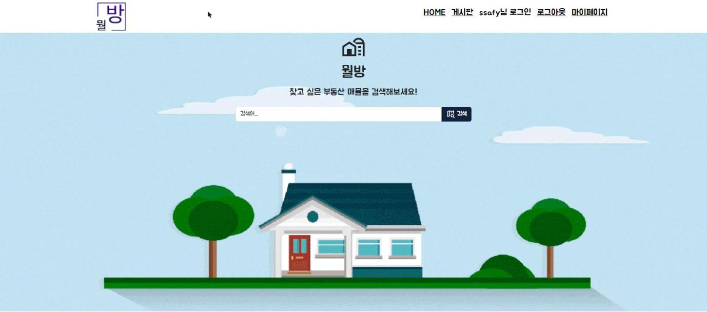
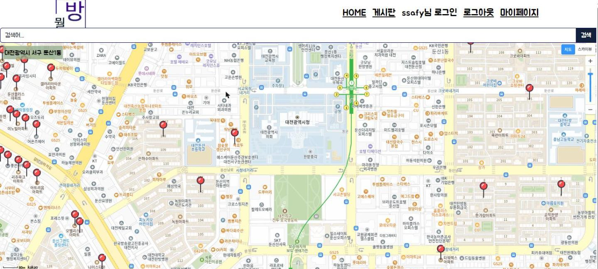
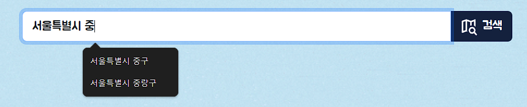
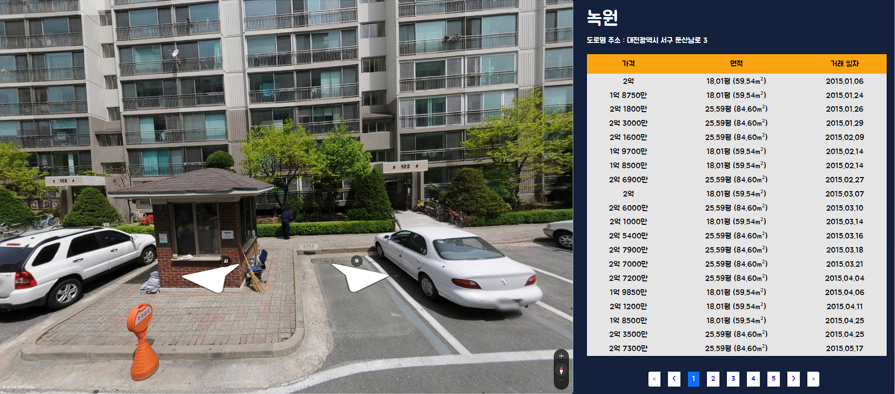
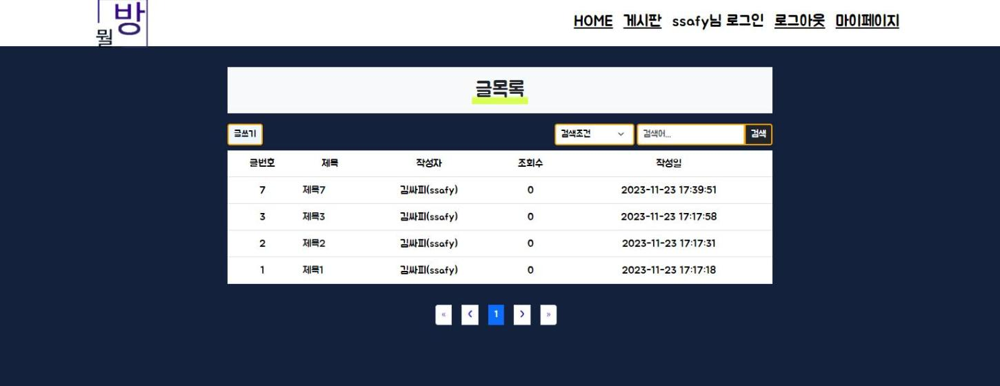
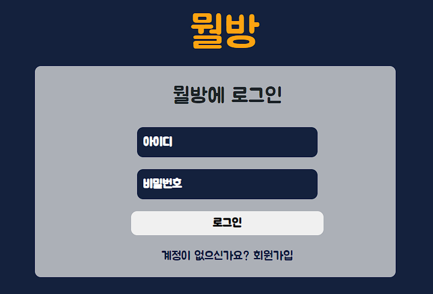
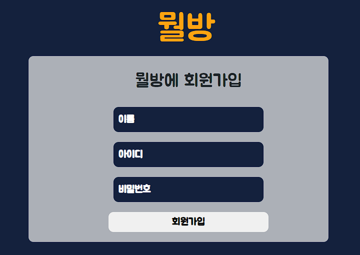
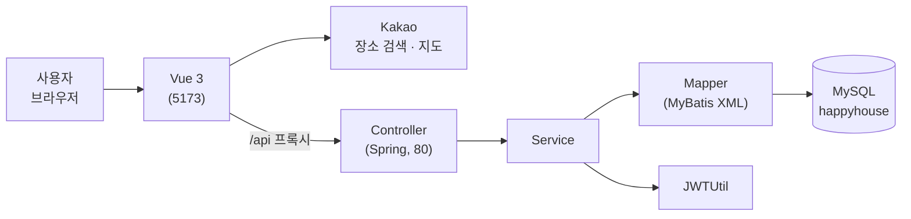

<div align="center">

# 뭘방 (Where-is-my-home)

**살고 싶은 동네의 아파트 실거래가를 지도에서!**

장소를 검색하면 주변 아파트와 실거래가를 카카오 지도에 보여 주는 부동산 조회 사이트입니다.


</div>

## 목차

- [소개](#-소개)
- [화면 구성](#-화면-구성)
- [주요 기능](#-주요-기능)
- [빠른 시작](#-빠른-시작)
- [기술 스택](#-기술-스택)
- [구조](#-구조)
- [API](#-api)
- [구현 포인트](#-구현-포인트)
- [설정과 주의사항](#-설정과-주의사항)

## ◆ 소개

장소 키워드로 지도를 옮기면, 지도 중심에서 반경 안에 있는 아파트를 DB에서 찾아 마커로 보여 줍니다. 마커를 누르면 실거래 내역과 로드뷰를 함께 볼 수 있고, 회원·게시판 기능이 있습니다.

- 기간: 2023, SSAFY 10기 1학기 파이널 프로젝트
- 형태: 2인 팀 프로젝트. 본인은 백엔드(Spring Boot · MyBatis · MySQL) 전체를 맡음
- 데이터: 국토교통부 아파트 실거래가(공공데이터포털)를 미리 받아 DB에 적재
- 2026.10 저장소 정리: 코드에 있던 키를 `.env`로 분리하고, 필요 없는 파일을 지우고, 문서와 [설계(UML)](docs/design.md)를 추가

## ◆ 화면 구성

<table>
  <tr>
    <th>홈</th>
    <th>매물 검색</th>
  </tr>
  <tr>
    <td align="center"><br>장소 키워드 검색</td>
    <td align="center"><br>반경 안 아파트를 지도 마커로 표시</td>
  </tr>
  <tr>
    <th>검색어 자동완성</th>
    <th>매물 상세</th>
  </tr>
  <tr>
    <td align="center"><br>입력한 글자로 시작하는 시·구 이름</td>
    <td align="center"><br>로드뷰와 실거래 내역(가격·면적·거래 일자)</td>
  </tr>
  <tr>
    <th>게시판</th>
    <th>로그인 · 회원가입</th>
  </tr>
  <tr>
    <td align="center"><br>글 목록, 페이징, 검색</td>
    <td align="center"> <br>JWT 로그인, 아이디 중복 확인</td>
  </tr>
</table>

## ◆ 주요 기능

- 🔎 **매물 검색**: 장소 키워드를 Kakao 로컬 API로 찾아 지도를 옮기고, 지도 중심에서 반경 안의 아파트를 조회해 마커로 표시합니다.
- ⌨ **검색어 자동완성**: 입력한 글자로 시작하는 시·구 이름을 후보로 보여 줍니다.
- 🏠 **매물 상세**: 아파트별 실거래 내역(가격·면적·거래 일자)과 도로명 주소, 로드뷰를 함께 봅니다.
- 👤 **회원**: 회원가입(아이디 중복 확인), JWT 로그인, 회원 정보 수정, 탈퇴
- 📝 **게시판**: 글 목록(페이징·검색), 상세(조회수), 작성, 수정, 삭제

## ◆ 빠른 시작

필요한 환경: JDK 11 이상(11, 17에서 확인), Node.js 18 이상, MySQL 8

### 1. DB 준비

MySQL에 `happyhouse` 스키마를 만들고 `mwolbang_DB/`의 SQL(게시판, 회원)을 넣습니다.
매물 데이터(`dongcode`, `houseinfo`, `housedeal`)는 용량이 커서 저장소에 포함하지 않습니다. 따로 받아서 같은 스키마에 넣어 주세요.

### 2. 키 넣기

각 폴더의 `.env`에 넣습니다. 어떤 키가 필요한지는 아래 [설정과 주의사항](#-설정과-주의사항)에 있습니다.

### 3. 백엔드 (http://localhost:80)

```bash
cd backend
./mvnw spring-boot:run -Dstart-class=com.ssafy.ws.WhereIsMyHomeDaejeon06KjhWcmApplication -Dspring-boot.run.main-class=com.ssafy.ws.WhereIsMyHomeDaejeon06KjhWcmApplication
```

`@SpringBootApplication` 클래스가 두 개 있어서 실행할 메인 클래스를 직접 지정합니다.

Windows(PowerShell)
```powershell
cd backend
.\mvnw.cmd spring-boot:run "-Dstart-class=com.ssafy.ws.WhereIsMyHomeDaejeon06KjhWcmApplication" "-Dspring-boot.run.main-class=com.ssafy.ws.WhereIsMyHomeDaejeon06KjhWcmApplication"
```

### 4. 프론트엔드 (http://localhost:5173)

```bash
cd frontend
npm install
npm run dev
```

브라우저에서 http://localhost:5173 을 엽니다.

## ◆ 기술 스택

| 분류 | 기술 |
| --- | --- |
| 백엔드 |    -000000?style=flat&logo=jsonwebtokens&logoColor=white) |
| DB |  |
| 프론트엔드 |       |
| 외부 API |  |
| 데이터 | 국토교통부 아파트 실거래가(공공데이터포털) |

## ◆ 구조



```
Where-is-my-home/
├── frontend/      # Vue 3 + Vite (5173 포트)
├── backend/       # Spring Boot + MyBatis (80 포트)
├── mwolbang_DB/   # 게시판, 회원 테이블 SQL
└── docs/          # 설계(UML), 화면 캡처
```

기능(매물·회원·게시판)마다 Controller → Service → Mapper 3계층으로 나눴습니다. 클래스 다이어그램, ERD, 시퀀스 다이어그램(로그인, 매물 검색)은 [docs/design.md](docs/design.md)에 있습니다.

## ◆ API

프론트엔드는 `/api`로 요청하고, Vite 프록시가 백엔드(80)로 넘깁니다.

| 분류 | Method | Endpoint | 기능 |
| --- | --- | --- | --- |
| 매물 | GET | `/house` | 지도 중심 좌표·반경 안의 아파트 조회 (페이징) |
| | GET | `/house/area` | 검색어로 시작하는 시·구 이름 |
| | GET | `/house/detail` | 아파트 실거래 내역 (페이징) |
| 회원 | GET | `/user/{userId}` | 아이디 중복 확인 |
| | POST | `/user/join` | 회원가입 |
| | POST | `/user/login` | 로그인, JWT 발급 (실패 시 401) |
| | PUT | `/user/edit` | 회원 정보 수정 |
| | DELETE | `/user/delete/{userId}` | 회원 탈퇴 |
| 게시판 | GET | `/board` | 글 목록 (페이징·검색) |
| | POST | `/board` | 글쓰기 |
| | GET | `/board/{articleno}` | 글 상세 (조회수 증가) |
| | GET | `/board/modify/{articleno}` | 수정할 글 조회 |
| | PUT | `/board` | 글 수정 |
| | DELETE | `/board/{articleno}` | 글 삭제 |

## ◆ 구현 포인트

- **지도 반경 안의 아파트만 찾기** → 위도·경도로 거리를 구하는 하버사인 공식을 SQL에 넣어, 지도 중심에서 반경 안의 아파트만 DB에서 바로 거름. 같은 조건의 전체 건수 쿼리를 따로 두어 페이징에 씀. ([House.xml](backend/src/main/resources/mapper/House.xml))
- **검색어 자동완성** → `dongcode` 테이블의 "시 구" 이름을 앞부분 일치(`LIKE '검색어%'`)로 조회함.
- **실거래 내역 보기 좋게** → `houseinfo`·`housedeal`을 조인하고, 거래 일자를 `2023.01.05`처럼 월·일 두 자리로 맞춰 내려 줌.
- **로그인 상태 유지** → 로그인에 성공하면 JWT를 발급하고, 실패하면 401을 돌려줌. 프론트엔드는 토큰을 저장해 로그인 상태를 유지함. ([로그인 시퀀스](docs/design.md#시퀀스-다이어그램-로그인))
- **코드에 들어 있던 키 (2026 정리)** → DB 비밀번호, JWT 비밀 키, Kakao 키를 `.env`로 옮기고 git에서 제외함. 용량이 큰 매물 SQL과 로그 파일도 저장소에서 뺌.

## ◆ 설정과 주의사항

### 키

| 키 | 쓰는 곳 | 넣는 곳 |
| --- | --- | --- |
| MySQL 계정 | 백엔드 DB 연결 | `backend/.env`의 `DB_USERNAME`, `DB_PASSWORD` |
| JWT 비밀 키 | 로그인 토큰 서명 | `backend/.env`의 `JWT_SECRET` (base64, 32바이트 이상) |
| Kakao JavaScript 키 | 지도, 로드뷰 | `frontend/.env`의 `VITE_KAKAO_MAP_SERVICE_KEY` |
| Kakao REST API 키 | 장소 검색 | `frontend/.env`의 `VITE_KAKAO_REST_SERVICE_KEY` |

`backend/.env`
```
DB_USERNAME=
DB_PASSWORD=
JWT_SECRET=   # base64, 32바이트 이상
```

`frontend/.env`
```
VITE_KAKAO_MAP_SERVICE_KEY=     # Kakao JavaScript 키
VITE_KAKAO_REST_SERVICE_KEY=    # Kakao REST API 키
VITE_ARTICLE_LIST_SIZE=20
VITE_ARTICLE_NAVIGATION_SIZE=5
```

Kakao 키는 [Kakao Developers](https://developers.kakao.com/)에서 앱을 만들어 받고, 플랫폼(Web)에 `http://localhost:5173`을 등록해야 지도가 뜹니다.

### 주의사항

- `.env`는 git에서 무시됩니다. 키를 커밋하지 마세요.
- 실거래가는 프로젝트 당시 받아 둔 데이터라 최신 거래가 아닙니다.
- 교육 과정에서 만든 학습용 프로젝트입니다.

## ◆ 더 보기

- [docs/design.md](docs/design.md): 클래스 다이어그램, ERD, 시퀀스 다이어그램(로그인, 매물 검색)
