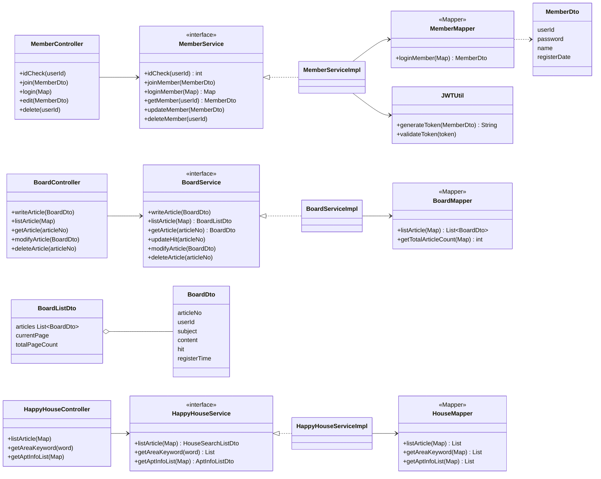
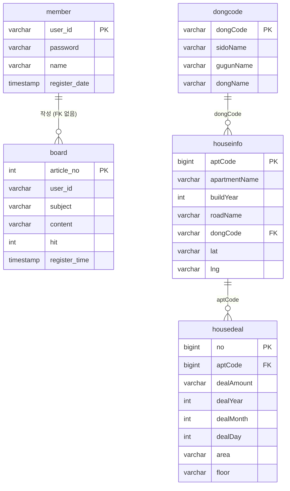
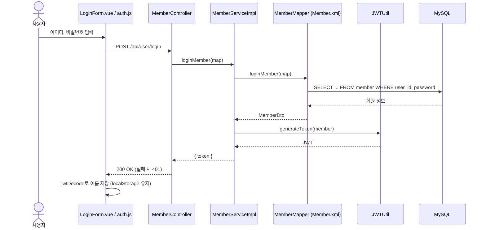
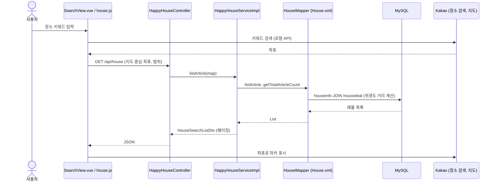

# Where-is-my-home (뭘방)

SSAFY 10기 1학기 파이널 프로젝트로 만든 부동산 실거래가 조회 사이트입니다.
장소를 검색하면 지도 주변 아파트의 실거래가를 보여 주고, 카카오 지도에서 위치와 로드뷰를 확인할 수 있습니다. 게시판과 회원 기능도 있습니다.

## 주요 기능

- **매물 검색**: 장소 키워드를 입력하면 Kakao 장소 검색으로 지도를 옮기고, 지도 중심 주변 아파트의 실거래가를 조회합니다.
- **지도**: 검색 결과를 카카오 지도에 마커로 표시하고, 상세 화면에서 로드뷰를 보여 줍니다.
- **회원**: 회원가입, 로그인(JWT), 마이페이지
- **게시판**: 글 목록(페이징, 검색), 상세, 작성, 수정, 삭제

## 기술 스택

| 구분 | 사용 기술 |
| --- | --- |
| Frontend | Vue 3, Vite, Pinia, Vue Router, Vuetify, Bootstrap, axios |
| Backend | Spring Boot 2.7, MyBatis, JWT(jjwt) |
| DB | MySQL 8 |
| 외부 API | Kakao Maps, Kakao 로컬(장소 검색) |
| 데이터 출처 | 국토교통부 아파트 실거래가(공공데이터포털), 미리 받아 DB에 적재 |

## 구조

```
Where-is-my-home/
├── frontend/      # Vue 3 + Vite (5173 포트)
├── backend/       # Spring Boot + MyBatis (80 포트)
└── mwolbang_DB/   # 게시판, 회원 테이블 SQL
```

요청 흐름: 브라우저 → Vue(5173) → Vite 프록시 `/api` → Spring(80) → MyBatis → MySQL

## 설계 (UML)

### 클래스 다이어그램 (백엔드)

기능마다 Controller → Service → Mapper(MyBatis XML) 3계층으로 나뉩니다.



### ERD

`board.user_id`와 `member.user_id`는 같은 값을 쓰지만 DB에 외래 키로 걸려 있지는 않습니다.
매물 테이블(`dongcode`, `houseinfo`, `housedeal`)은 주요 컬럼만 적었습니다.



### 시퀀스 다이어그램 (로그인)



### 시퀀스 다이어그램 (매물 검색)



## 실행 방법

필요한 환경: JDK 11 이상(11, 17에서 확인), Node.js 18 이상, MySQL 8

### 1. DB 준비

MySQL에 `happyhouse` 스키마를 만들고 `mwolbang_DB/`의 SQL(게시판, 회원)을 넣습니다.
매물 데이터(`dongcode`, `houseinfo`, `housedeal`)는 용량이 커서 저장소에 포함하지 않습니다. 따로 받아서 같은 스키마에 넣어 주세요.

### 2. 환경 변수

키는 커밋하지 않고 각 폴더의 `.env`에 넣습니다. `.env`는 git에서 무시됩니다.

`backend/.env`
```
DB_USERNAME=
DB_PASSWORD=
JWT_SECRET=   # base64, 32바이트 이상
```

`frontend/.env`
```
VITE_KAKAO_MAP_SERVICE_KEY=     # Kakao JavaScript 키
VITE_KAKAO_REST_SERVICE_KEY=    # Kakao REST API 키
VITE_ARTICLE_LIST_SIZE=20
VITE_ARTICLE_NAVIGATION_SIZE=5
```

### 3. 백엔드 (http://localhost:80)

```bash
cd backend
./mvnw spring-boot:run -Dstart-class=com.ssafy.ws.WhereIsMyHomeDaejeon06KjhWcmApplication -Dspring-boot.run.main-class=com.ssafy.ws.WhereIsMyHomeDaejeon06KjhWcmApplication
```

`@SpringBootApplication` 클래스가 두 개 있어서 실행할 메인 클래스를 직접 지정합니다.

Windows(PowerShell)
```powershell
cd backend
.\mvnw.cmd spring-boot:run "-Dstart-class=com.ssafy.ws.WhereIsMyHomeDaejeon06KjhWcmApplication" "-Dspring-boot.run.main-class=com.ssafy.ws.WhereIsMyHomeDaejeon06KjhWcmApplication"
```

### 4. 프론트엔드 (http://localhost:5173)

```bash
cd frontend
npm install
npm run dev
```

브라우저에서 http://localhost:5173 을 엽니다.
