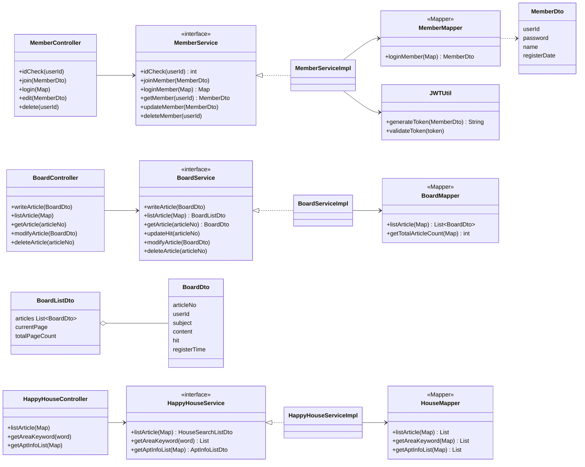
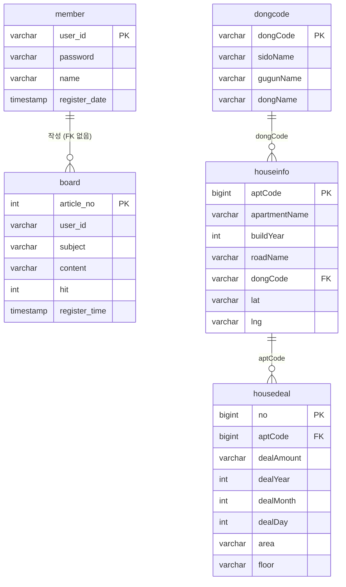
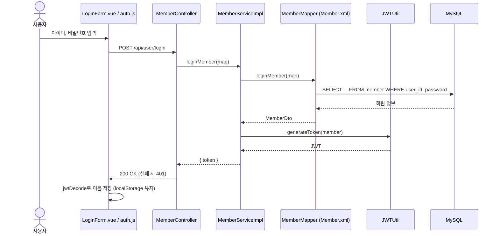
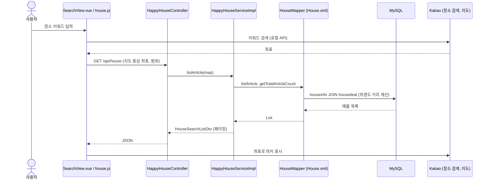

# 설계 (UML)

[README로 돌아가기](../README.md)

## 클래스 다이어그램 (백엔드)

기능마다 Controller → Service → Mapper(MyBatis XML) 3계층으로 나뉩니다.

## ERD

`board.user_id`와 `member.user_id`는 같은 값을 쓰지만 DB에 외래 키로 걸려 있지는 않습니다.
매물 테이블(`dongcode`, `houseinfo`, `housedeal`)은 주요 컬럼만 적었습니다.

## 시퀀스 다이어그램 (로그인)

## 시퀀스 다이어그램 (매물 검색)

